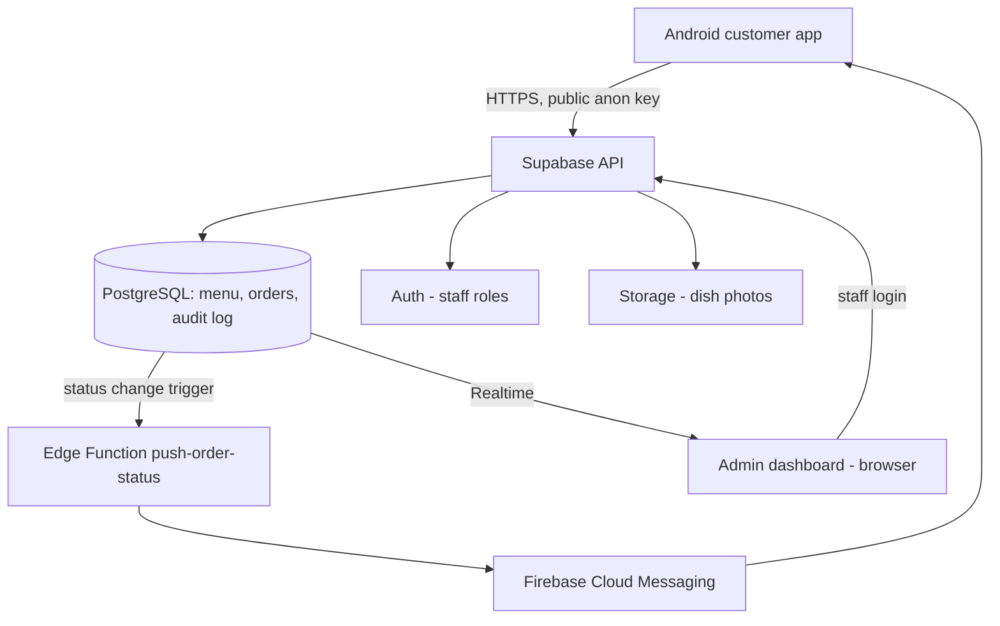

# Swad Sangam — Restaurant App

Android app, restaurant admin dashboard and backend for **Swad Sangam**, a North Indian restaurant at
Bhaktiyana, Badrinath Marg, near NIT Ground, Srinagar, Uttarakhand. Built from the PRD in
[`docs/`](docs/PRD_TRACEABILITY.md) — every requirement is mapped to code in **docs/PRD_TRACEABILITY.md**.

> **Owner ke liye:** coding ki zaroorat nahi. Bas **[docs/SETUP_GUIDE.md](docs/SETUP_GUIDE.md)** ke steps follow karo.
> Sab kuch free hai; sirf Google Play Store account ek baar $25 ka hai (optional — APK directly bhi share kar sakte ho).

## What’s inside

| Folder | What it is | Tech |
|---|---|---|
| `android/` | Customer app: menu, search, cart, pickup/dine-in/delivery ordering, live order status, notifications, call & directions, English + Hindi, works offline | Kotlin, Jetpack Compose, MVVM, Hilt, Room, Retrofit, Coil, WorkManager, optional Firebase (FCM + Crashlytics) |
| `admin-dashboard/` | Restaurant dashboard: live orders with alert sound, kitchen queue, menu & photo management, offers & coupons, settings, staff roles, reports, feedback, audit log, printable QR codes, privacy policy & terms pages | React + TypeScript + Vite (static site) |
| `supabase/` | Backend: database, security rules, server-side pricing & order logic, push-notification function, tests | Supabase (PostgreSQL, Auth, Storage, Realtime, Edge Functions) |
| `.github/workflows/` | Free cloud automation: builds the APK/AAB, runs tests, deploys dashboard & backend, keeps the free database awake, creates the signing key | GitHub Actions |
| `docs/` | Setup guide, Play Store pack, launch checklist, PRD traceability, store graphics | |

## How it fits together



Key rules enforced **in the database**, not in the app (so they can’t be bypassed):
prices recalculated on every order · unavailable items rejected · duplicate submissions blocked (idempotency key) ·
unique order numbers `SS-2026-0001` · immutable price snapshots · only valid status changes · role-based access
(Owner / Manager / Staff / Kitchen) · every admin change audited · ordering switches **off** until the owner turns them on.

## Cost

| Item | Cost |
|---|---|
| Supabase (database, login, photos, realtime, functions) | Free plan |
| GitHub (code, cloud builds, dashboard hosting if public) / Netlify | Free |
| Firebase push notifications + crash reports (optional) | Free (Spark plan) |
| Google Play developer account (optional) | **$25 one-time** |
| Online payment gateway (Phase 2, not built) | Per-transaction fee charged by the gateway |

## Developer quick start

```bash
# Backend tests (needs PostgreSQL 15+ running locally)
PGHOST=localhost PGUSER=postgres ./supabase/tests/run_local.sh

# Dashboard
cd admin-dashboard && cp .env.example .env.local   # fill in Supabase URL + anon key
npm install && npm run dev                          # http://localhost:5173
npm test && npm run build

# Android (JDK 17 + Android SDK 36)
cd android
echo "SUPABASE_URL=https://xxxx.supabase.co" >> local.properties
echo "SUPABASE_ANON_KEY=..." >> local.properties
./gradlew testDebugUnitTest assembleDebug bundleRelease
```

UI strings live in `android/tools/gen_strings.py` (English + Hindi in one table) — run it after editing.

## Status

Engineering is complete for the MVP plus the Phase 2/3 items listed as built in `docs/PRD_TRACEABILITY.md`.
Going live still needs the owner approvals in `docs/LAUNCH_CHECKLIST.md` (verified prices, photos, hours, FSSAI,
tax treatment, privacy-policy review) and Google Play review.
